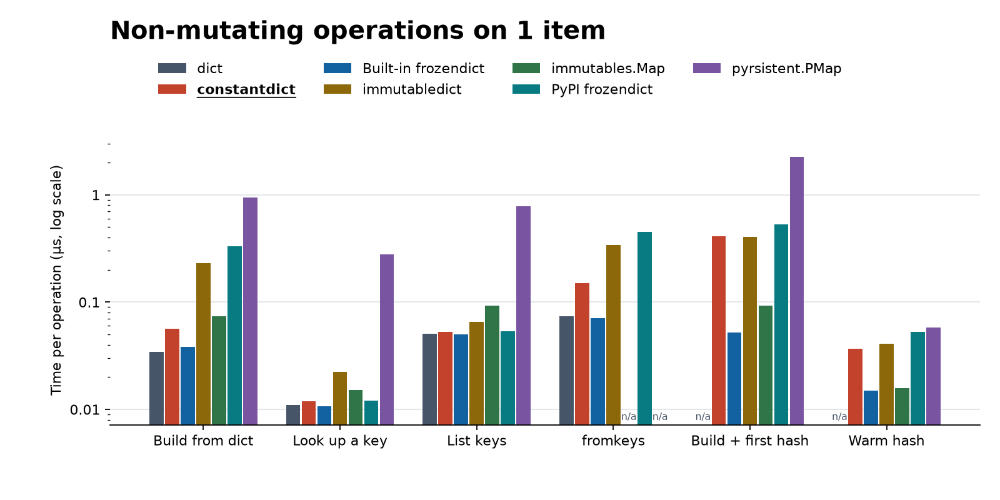
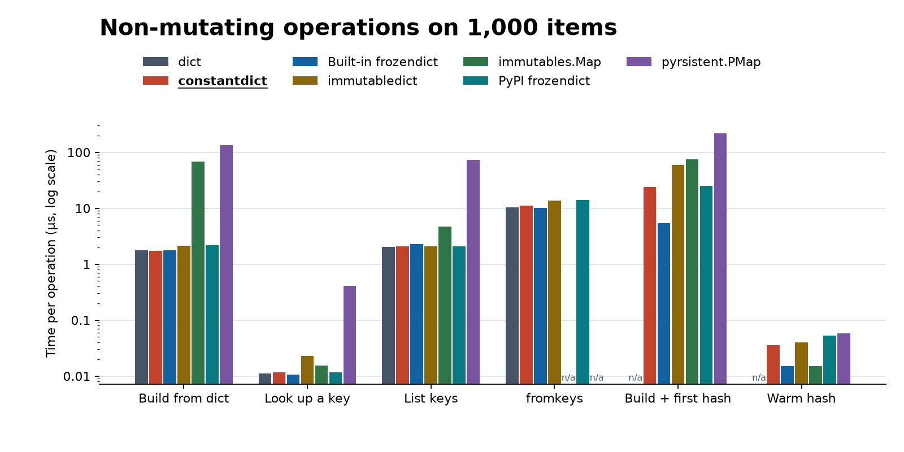
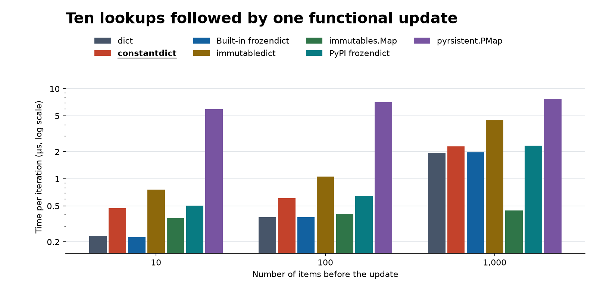

Comparison of dictionary implementations
========================================

Features
--------

.. list-table::
   :header-rows: 1

   * - Package
     - License
     - Deterministic iteration order
     - Frozen/Immutable
     - Mutation algorithm [#f1]_
   * - :class:`dict`
     - ✅ PSF
     - ✅
     - ❌
     - 🟡 Single copy
   * - :class:`~constantdict.constantdict`
     - ✅ MIT
     - ✅
     - ✅
     - 🟡 Single copy
   * - :class:`frozendict` (built-in)
     - ✅ PSF
     - ✅
     - ✅
     - 🟡 Single copy
   * - :class:`~immutabledict.immutabledict`
     - ✅ MIT
     - ✅
     - ✅
     - ❌ Double copy
   * - `immutables.Map <https://github.com/MagicStack/immutables>`__
     - ✅ Apache 2.0
     - ❌
     - ✅
     - ✅ Partial copy
   * - `frozendict (PyPI) <https://github.com/Marco-Sulla/python-frozendict>`__
     - ❌ LGPL-3.0
     - ✅
     - ✅
     - ❌ Double copy
   * - :class:`pyrsistent.PMap`
     - ✅ MIT
     - ❌
     - ✅
     - ✅ Partial copy

.. [#f1] Mutation algorithms are the following:

    Single copy (dict, constantdict, built-in frozendict):

    .. code-block:: python

          # dict:
          new_dict = dict(old_dict)  # copy
          new_dict[key] = value  # mutation

          # constantdict:
          new_dict = old_dict.mutate()  # copy
          new_dict[key] = value  # mutation
          new_dict = new_dict.finish()  # no copy

          # built-in frozendict:
          new_dict = old_dict | {key: value}  # copy and merge

    Double copy (immutabledict, PyPI frozendict):

    .. code-block:: python

          new_dict = dict(old_dict)  # copy
          new_dict[key] = value  # mutation
          new_dict = immutabledict(new_dict)  # copy

    Partial copy (immutables.Map, pyrsistent.PMap): Similar to single copy, but only the changed nodes need to be updated/added.

Performance
-----------

The measurements use CPython 3.15.2 on an Apple M4 Mac (Mac16,1, 10 CPU cores,
16 GiB RAM) running macOS 27.2.1 on arm64. The package versions were
constantdict 2025.3, immutabledict 4.3.1, immutables 0.21, PyPI frozendict
2.5.1, and pyrsistent 0.20.0. The PyPI frozendict and pyrsistent installations
used their pure Python implementations. The immutables installation used
its C extension.

The charts show median time per operation or workload iteration across five
timing samples, with a fixed ``PYTHONHASHSEED=1``. Each chart uses a logarithmic
time axis.

Non-mutating operations
~~~~~~~~~~~~~~~~~~~~~~~

Code
****

These results were generated with the following code, found in
`examples/speed.py <https://github.com/matthiasdiener/constantdict/blob/main/examples/speed.py>`__ in the
source distribution:

.. raw:: html

    

.. literalinclude:: ../examples/speed.py
   :language: python

.. raw:: html

    

Results
*******

Each sample runs an operation 10,000 times. Lookups, key listing, and warm
hashes use an existing mapping. The first-hash measurement includes
construction of a fresh mapping. The charts label unavailable operations
as ``n/a``.

At 1,000 items, constructing and hashing a new built-in ``frozendict``
took 5.4 μs. The same operation took 24.2 μs for ``constantdict``.

:download:`Download the one-item chart (PDF) <dict_performance_small.pdf>`

:download:`Download the 1,000-item chart (PDF) <dict_performance_large.pdf>`

Mutating operations
~~~~~~~~~~~~~~~~~~~

Code
****

These results were generated with the following code, found in
`examples/speed_mutation.py <https://github.com/matthiasdiener/constantdict/blob/main/examples/speed_mutation.py>`__ in the
source distribution:

.. raw:: html

    

.. literalinclude:: ../examples/speed_mutation.py
   :language: python

.. raw:: html

    

Results
*******

Each sample runs 100,000 iterations. An iteration reads an existing key ten
times and adds one new key to a fresh result. The built-in ``dict`` uses
``copy()`` followed by ``update()``, the built-in ``frozendict`` uses
``|``, the PyPI ``frozendict`` uses ``set()``, and the other mappings use
their functional ``update()`` methods.

At 1,000 items, one iteration took 2.0 μs for the built-in ``frozendict``,
2.3 μs for ``constantdict``, and 0.45 μs for ``immutables.Map``.

:download:`Download the mutation chart (PDF) <dict_performance_mutation.pdf>`

Reproducing the charts
~~~~~~~~~~~~~~~~~~~~~~

Run the following from the repository root in a Python 3.15 environment.
The final command writes PNG and PDF files to ``doc/``.

.. code-block:: bash

    python3.15 -m pip install -e . matplotlib==3.11.2 \
        frozendict==2.5.1 immutabledict==4.3.1 immutables==0.21 pyrsistent==0.20.0
    benchmark_dir=$(mktemp -d)
    PYTHONHASHSEED=1 python3.15 examples/speed.py > "$benchmark_dir/operations.json"
    PYTHONHASHSEED=1 python3.15 examples/speed_mutation.py > "$benchmark_dir/mutation.json"
    python3.15 doc/plot_performance.py "$benchmark_dir/operations.json" \
        "$benchmark_dir/mutation.json"
